# Multienv

Multienv is a terminal workspace for moving between tmux sessions and windows across
multiple hosts. It helps you find a piece of work and return to it without remembering
which machine, SSH connection or window you left it in.

Open the dashboard inside tmux, search the combined session list, and press Enter to
switch. Names, commands and directories help you recognize each session; its windows
appear on the right. A workstation launcher handles connections between hosts, so
you can move between local and remote work from the same interface.

Optional Codex integration builds on that tmux workspace: find a conversation by
title or activity, jump to its running pane, or resume it in a tmux window. Desktop
commands also let you send notifications and open links on your workstation from
a remote shell.

## Requirements

Run one coordinating server and install the agent on each managed host. The examples
use a macOS workstation, called the **master**, and one or more Linux hosts. The tmux
workflow works on macOS and Linux; the current desktop notification and open commands
require the server to run on macOS.

| Component | Required tools |
| --- | --- |
| Building | Go 1.25.14 or newer, Make |
| Each managed host | tmux, `multienv-agent` |
| Each host running the dashboard | Bash 4+, jq, recent fzf, `realpath`, standard Unix tools |
| Workstation launcher and forwarder | Bash 4+, SSH client, jq |
| Switching between hosts | OpenBSD-compatible `nc` with `-k` support on the workstation and TUI hosts |
| Remote hosts | SSH server, reachable from the master with noninteractive authentication |
| Server | SSH client, Redis with JSON command support; the bundled setup uses Redis 8.2 |
| Bundled Redis setup | Docker Compose, OpenSSL, `shasum` |
| Desktop commands, optional | macOS on the server host, with `osascript` and `/usr/bin/open` |
| macOS background services, optional | launchd, jq, Mike Farah's `yq`, `jinja2` CLI |

Use tmux 3.3+ for popup support. fzf must support `--tmux`, `--id-nth` and the
`every(...)` binding; the current UI has been used with fzf 0.74.4.

For optional Codex integration, install `lsof` and a Codex CLI with `--no-daemon`,
`resume`, `archive`, `unarchive` and `delete` commands, and compatible local session
data. The integration uses `CODEX_HOME` when set, otherwise `~/.codex`.

## Installation and setup

The examples use `macbook` for the master and `devbox` for a remote host. Replace
these with the exact output of `hostname` on each machine. Host identity matters:
SSH aliases can be friendly names, but server host lists use the actual hostnames.
The examples use HTTP port `12401` and control port `12400`; the built-in defaults
are `12123` and `7777`. Keep the configured ports consistent across the examples.

### 1. Install the programs

Clone this repository on each host and run the following from the checkout.
On the master:

```sh
mkdir -p ~/.bin ~/.config/multienv
make -C deploy local
```

On each remote host:

```sh
mkdir -p ~/.bin ~/.config/multienv
make -C deploy remote
```

This builds the Go binaries into `~/.bin` and links the shell programs to the
checkout. Keep the checkout in place while those links are installed. Add `~/.bin`
to `PATH` in your shell configuration. On macOS, also put your installed Bash 4+
ahead of `/usr/bin`; for an Apple Silicon Homebrew installation, for example:

```sh
export PATH="$HOME/.bin:/opt/homebrew/bin:$PATH"
```

Install matching versions across your hosts when updating Multienv. The
`remote-ssh` Make target contains a project-specific host and path; use the
per-host installation commands above for your own setup.

### 2. Start Redis on the master

The bundled deployment creates an application password and keeps Redis data in
a Docker volume. These commands use Docker Compose v2; omit the `COMPOSE` override
if your installation provides `docker-compose`.

```sh
make -C deploy/db/redis COMPOSE='docker compose -f compose.yaml' up

umask 077
printf 'username: app\npassword: %s\n' "$(cat deploy/db/redis/password)" \
    > ~/.config/multienv/redis-credentials.yaml
```

You can use an existing Redis instance with JSON support instead. Set its address,
port, database and credentials in the server configuration below.

### 3. Configure and start the server

Create `~/.config/multienv/server.yaml` on the master:

```yaml
server:
  address: 127.0.0.1
  port: 12401

tmux:
  hosts:
    - macbook
    - devbox

codex:
  hosts: []

storage:
  address: 127.0.0.1
  port: 6379
  db: 0
  credentials_path: ~/.config/multienv/redis-credentials.yaml
```

`tmux.hosts` lists the machines to synchronize. Codex collection is disabled in this
example; its optional integration has a separate host list, described below.
Start the server in a terminal and leave it running:

```sh
multienv-server
```

Both server and agent accept `--config PATH` or `-c PATH` for an alternative YAML
file. The HTTP API has no authentication; keep it on loopback and use SSH tunnels
for access from other machines.

### 4. Configure the agents

Create `~/.config/multienv/agent.yaml` on every host, including the master:

```yaml
client:
  url: http://127.0.0.1:12401
  timeout: 3s
```

On remote hosts, this URL will reach the master through the tunnel in the next
step. Increase the timeout if collecting snapshots from your hosts takes longer.

The agent runs when a command is requested; there is no agent daemon to start.
The server invokes `~/.bin/multienv-agent` on remote hosts over SSH. Make sure `tmux`
is available in noninteractive SSH sessions. For Codex integration, also make `lsof`,
`codex` and any custom `CODEX_HOME` setting available in that environment.

### 5. Connect the hosts

The master must be able to SSH to each managed host without a password prompt.
For example, add this to `~/.ssh/config` on the master:

```sshconfig
Host dev devbox
    HostName devbox.example.net
    User alice
```

Here, `devbox` matches the remote machine's actual hostname and `dev` is a short
alias. Check the connection and remote installation:

```sh
ssh -T -o BatchMode=yes devbox '~/.bin/multienv-agent tmux list-local'
```

Two reverse forwards let programs on `devbox` reach the master's HTTP server and
local terminal launcher. Create `~/.config/multienv/forwarder.json` on the master:

```json
{
  "ssh_host": "devbox",
  "connection": {
    "connect_timeout_seconds": 10,
    "connection_attempts": 1,
    "server_alive_interval_seconds": 3,
    "server_alive_count_max": 3,
    "retry_delay_seconds": 5
  },
  "forwards": [
    {"direction": "R", "spec": "127.0.0.1:12401:127.0.0.1:12401"},
    {"direction": "R", "spec": "127.0.0.1:12400:127.0.0.1:12400"}
  ]
}
```

From the checkout on the master, run this in another terminal and leave it running:

```sh
bash forward/bin/ssh_port_forwarder.sh --config ~/.config/multienv/forwarder.json
```

The optional `connection` section controls SSH timeouts, keepalive probes and the
delay before reconnecting. Run a separate forwarder instance and configuration for
each remote host. You can also maintain equivalent SSH forwards yourself. The remote
SSH server must allow TCP forwarding.

### 6. Configure the terminal UI

Create `~/.config/multienv/tui.sh` on hosts where you use the terminal programs:

```bash
c_host_alias_to_hostname[mac]=macbook
c_host_alias_to_hostname[dev]=devbox
c_ctrl_port=12400
```

These aliases label hosts in the UI. The workstation launcher also uses them for
interactive SSH, so `dev` must resolve through the master's SSH configuration.
Use the same control port as your reverse forward.

Create an initial tmux session on the master, then start the launcher **outside
tmux** in your workstation terminal:

```sh
tmux new-session -d -s main
multienv main
```

The launcher attaches to that session and handles future connections between hosts.
Inside tmux, open the dashboard:

```sh
multienv-tui
```

Local session switching also works when you attach to tmux directly. To switch
between machines, start through `multienv` and keep the control-port forward active
on remote hosts. A TUI running remotely can then return you to the master or move
you to another managed host through the workstation launcher.

### Optional: run background services with launchd

On macOS, the repository includes launchd helpers for the server and SSH forwarder.
Create `~/.config/multienv/server.launchd.yaml`:

```yaml
label: local.multienv.server
program_path: ~/.bin/multienv-server
config_path: ~/.config/multienv/server.yaml
stdout_path: ~/Library/Logs/multienv/server.log
stderr_path: ~/Library/Logs/multienv/server.err.log
environment:
  PATH: "${HOME}/.bin:/opt/homebrew/bin:/usr/local/bin:/usr/bin:/bin:/usr/sbin:/sbin"
  # SSH_AUTH_SOCK: "${HOME}/.ssh/agent.sock"  # Replace with your agent's socket if needed.
```

Create `~/.config/multienv/forward.launchd.yaml` for the forwarder. This example
assumes the checkout is at `~/src/multienv`; update `program_path` to match yours.

```yaml
label: local.multienv.forward
program_path: ~/src/multienv/forward/bin/ssh_port_forwarder.sh
config_path: ~/.config/multienv/forwarder.json
stdout_path: ~/Library/Logs/multienv/forward.log
stderr_path: ~/Library/Logs/multienv/forward.err.log
environment:
  PATH: "${HOME}/.bin:/opt/homebrew/bin:/usr/local/bin:/usr/bin:/bin:/usr/sbin:/sbin"
  # SSH_AUTH_SOCK: "${HOME}/.ssh/agent.sock"  # Replace with your agent's socket if needed.
```

launchd does not read your shell startup files. Extend `PATH` with the directories
containing your tmux, Codex and other required tools. Set `SSH_AUTH_SOCK` if your SSH
authentication relies on an agent, and `CODEX_HOME` if you use a custom location.

```sh
make -C deploy/launchd/server enable
make -C deploy/launchd/forward enable
```

The same directories provide `status`, `logs`, `render` and `disable` targets.
`enable` replaces and restarts an existing service. Stop manually started instances
before enabling the corresponding services.

## Uninstalling

Stop the launcher and any manually started server or forwarder with Ctrl-C.
If you enabled launchd services, disable them while their configuration files
still exist:

```sh
make -C deploy/launchd/forward disable
make -C deploy/launchd/server disable
```

On each host, remove the installed programs and links:

```sh
rm -f ~/.bin/multienv ~/.bin/multienv-tui \
    ~/.bin/multienv-agent ~/.bin/multienv-server
```

To stop the bundled Redis instance while keeping its data:

```sh
make -C deploy/db/redis COMPOSE='docker compose -f compose.yaml' down
```

Optionally remove `~/.config/multienv`, the checkout and any SSH settings you added.
To also remove the bundled Redis volume, run
`docker compose -f deploy/db/redis/compose.yaml down -v` before deleting the checkout.
Uninstalling Multienv leaves your tmux sessions and Codex conversations in place.

## Using the TUI

```sh
multienv-tui                 # Start in tmux mode
multienv-tui codex           # Start in Codex mode
multienv-tui doctor          # Open the diagnostics view
multienv-tui --no-popup      # Use the current pane instead of a popup
multienv-tui --help
```

The Go TUI runs from the checkout with `go run ./tui/cmd`, or install it with
`make -C deploy install-tui` and run `multienv-tui [tmux|codex|doctor]`.
Use `--no-popup` for the current pane and `--doctor` for a diagnostic report.
It reads `~/.config/multienv/tui.yaml`; `--config` overrides only this TUI file.
The agent configuration is always read from `~/.config/multienv/agent.yaml`.

```yaml
host_aliases:
  mac: macbook
  dev: devbox

popup:
  enabled: true
  width: 90%
  height: 90%

log_file: /tmp/multienv-tui-go.log

keybindings:
  switch-view: [ctrl+b]
  doctor: [ctrl+/, ctrl+_, f1]

tmux:
  control_port: 12400
  remote_pane_preview: false
  keybindings:
    create: [ctrl+n]
    rename: [ctrl+r]
    move-window: [ctrl+o]
    delete: [ctrl+x]

codex:
  ignore_file: ~/.config/multienv/.multienv-tui-ignore
  keybindings:
    archive: [ctrl+a]
    unarchive: [ctrl+u]
    delete: [ctrl+x]
```

The Go TUI uses Go regular expressions in the ignore file.
Key bindings map action names to lists of lowercase key names. Omitted actions use their defaults;
an empty list disables an action. Root bindings are shared; `tmux`, `codex` and `doctor` can override them.
The control port must match the launcher.

Run the dashboard inside tmux. Type to search, use arrow keys or Ctrl-J/Ctrl-K to
move, and press Enter to open the current item. Tab marks sessions for batch actions;
Enter always opens just the current item. `?` toggles the help header. Ctrl-B switches
between tmux and the optional Codex view. Ctrl-/ or F1 opens doctor directly.
The doctor view shows a searchable, colored report from `multienv-tui --doctor`;
Ctrl-R reruns it, and Esc, Ctrl-/ or F1 returns to the previous view.
Esc closes the dashboard when the session list has focus.
The list and preview refresh every three seconds.
Search matches only the session name (or the title in Codex mode) and the displayed host.
Ctrl-V toggles searching all visible fields, including the tmux command and directory;
the prompt shows `[all]` while this mode is active. Press Ctrl-V again to return to name and host search.

If tmux consumes Ctrl-B as its prefix, use its send-prefix binding to pass that key
to the dashboard; with the default bindings, press Ctrl-B twice.

### Tmux sessions and windows

Sessions are ordered by their last attachment time across all hosts, newest first.
Each row shows the host, window count, command and directory of the active window's
active pane.

- A green `●` means at least one client is attached.
- A red `!` means the snapshot is older than 30 seconds and takes precedence over the dot.
- The right pane lists windows by index, one line each, with a dot on the active window.
- The active pane's contents appear below the window list when available. The
  preview follows the selected window when the window list has focus and refreshes
  every three seconds. Remote previews are disabled by default; set
  `tmux.remote_pane_preview: true` in `tui.yaml` to enable them.

| Key | Action |
| --- | --- |
| Enter in the session list | Switch to the session's active window |
| Ctrl-L | Focus the windows on the right; retain the left list, selection and query |
| j/k, arrows, Ctrl-J/Ctrl-K in the window list | Choose a window |
| Enter in the window list | Switch directly to the chosen window |
| Ctrl-H or Esc in the window list | Return focus to the sessions |
| Ctrl-V in the session list | Toggle name/host search and search across all visible fields |
| Ctrl-N in the session list | Create a session; choose its host and name |
| Ctrl-N in the window list | Choose a directory and create a window with an automatic name |
| Ctrl-O in the window list | Move the selected window to a new index |
| Ctrl-R in the session list | Rename the current session |
| Ctrl-R in the window list | Rename the selected window |
| Ctrl-X in the session list | Kill marked sessions, or the current session if none are marked |
| Ctrl-X in the window list | Kill the selected window; the last window is protected |

The directory picker starts with the selected window’s current directory and includes
directories from zoxide when it is installed on that host. Esc cancels creation.

### Optional Codex integration

To collect Codex conversations, add their hosts to `codex.hosts` in the server
configuration and restart the server. For example:

```yaml
codex:
  hosts:
    - macbook
    - devbox
```

Install the Codex dependencies above on those hosts. The integration uses the same
agent, SSH connections and tmux sessions as the main workspace. Press Ctrl-B in the
dashboard, or start with `multienv-tui codex`, to open the conversation view.

The list shows an activity indicator, state, host and conversation title. A green `●`
means the session has a mapped tmux pane. A red `!` means the snapshot is older than
30 seconds and takes precedence over the dot. `Working (bg)` identifies active work
without a mapped tmux pane. The preview includes the working directory, first and
latest messages, and snapshot age. Conversations are ordered by state:
ActionRequired, Idle, Working, Not Loaded, Unknown, Archived.

| Key | Action |
| --- | --- |
| Enter | Switch to a running session's pane or prepare and resume an inactive session |
| Ctrl-A | Archive marked sessions, or the current session |
| Ctrl-U | Unarchive marked sessions, or the current session |
| Ctrl-X | Delete marked sessions, or the current session |
| Ctrl-G | Show or hide archived sessions |
| Ctrl-T | Show or hide sessions matching the ignore file |
| Ctrl-V | Toggle title/host search and search across all visible fields |

When a session needs resuming, choose a tmux session on its host and Multienv creates
a window for it. With `--no-popup`, resuming a local session replaces the dashboard
in the current pane. Archive and delete operations also close an associated tmux
pane when one is found.

Archived and ignored sessions are hidden initially. Their visibility is shown in the title;
the toggles are independent.

### Ignore rules and logs

Codex ignore rules live in `~/.config/multienv/.multienv-tui-ignore`. Each nonempty
line is a case-sensitive Go regular expression; lines beginning with optional
whitespace and `#` are comments. Rules are reread on refresh. For example:

```text
# Hide background work
^Working \(bg\)\t
# Hide titles beginning with scratch:
^[^\t]*\t[^\t]*\tscratch:
```

Rules match the full row with colors and the activity indicator removed; its first
three tab-separated fields are state, host alias and title. Rules can also match the
hostname, ID and encoded session data that follow. Use anchors to target the visible
fields.

Override the ignore file or shell log path in `tui.sh`:

```bash
c_tui_ignore_file_path="${HOME}/.config/multienv/custom-ignore"
c_log_file_path="/tmp/multienv-tui.log"
```

Agent output and UI errors are appended to `/tmp/multienv-tui-last-run.log`.
For stale remote sessions, check server logs, SSH access from the master, and
`multienv-agent tmux list-local` on the affected host.

## CLI and scripting

The launcher accepts `multienv SESSION [HOSTNAME]`; the host defaults to the current
machine. The agent accepts a shared configuration flag:

```sh
multienv-agent [--config PATH] tmux COMMAND
multienv-agent [--config PATH] codex COMMAND
multienv-agent [--config PATH] master COMMAND
multienv-agent [--config PATH] filesystem COMMAND
multienv-agent help tmux
```

In the `tmux`, `codex`, `master` and `filesystem` command trees, parameters are read as one JSON
object from stdin. Commands that return a result write JSON to stdout; logs and errors go to stderr. Successful
commands without a result produce no stdout output.

### Diagnostics

If something is not working, run `multienv-agent doctor global`, or
`multienv-tui --doctor` to include TUI checks. See each command's `--help` for details.

### Session queries and synchronization

Both `tmux` and `codex` provide:

| Command | Purpose |
| --- | --- |
| `list-local` | Read this host's sessions, keyed by session ID; no server request |
| `list-all` | Combine server snapshots with a fresh local snapshot, grouped by hostname and ID |
| `sync-local` | Publish this host's snapshot to the server |
| `sync-all` | Ask the server to collect snapshots from the configured hosts |

```sh
multienv-agent tmux list-all | jq
multienv-agent codex list-local | jq
multienv-agent tmux sync-all
```

`list-all` falls back to local sessions if the server cannot be reached. `sync-all`
can complete while individual hosts fail; check server logs and snapshot ages.

### Tmux operations

| Command | JSON fields |
| --- | --- |
| `pane-preview` | `hostname`, `target` |
| `new-session` | `hostname`, `name` |
| `rename-session` | `hostname`, `session_id`, `new_name` |
| `rename-window` | `hostname`, `session_id`, `window_id`, `new_name` |
| `kill-session` | `hostname`, `session_id` |
| `kill-window` | `hostname`, `session_id`, `window_id` |
| `new-window` | `hostname`, `session_id`; optional `name`, `work_dir`, `command` (an argument array) |
| `move-window` | `hostname`, `session_id`, `window_id`, `new_index` |

```sh
printf '%s\n' '{"hostname":"devbox","name":"project"}' | multienv-agent tmux new-session
printf '%s\n' '{"hostname":"devbox","session_id":"$1","new_name":"backend"}' \
    | multienv-agent tmux rename-session
```

Use the IDs returned by the queries. `new-session` returns the session object;
`new-window` returns `{"tmux_pane_id":"%..."}` for the new window's initial pane.

### Codex operations, optional

Each of these takes `hostname` and `session_id`:

| Command | Purpose |
| --- | --- |
| `archive-session` | Archive the conversation and close its mapped tmux pane |
| `unarchive-session` | Make the conversation available again |
| `delete-session` | Delete the conversation and close its mapped tmux pane |
| `prepare-resume` | Unarchive if needed, check readiness and directory, and return the session |

```sh
printf '%s\n' '{"hostname":"devbox","session_id":"YOUR_CODEX_SESSION_ID"}' \
    | multienv-agent codex prepare-resume
```

`prepare-resume` prepares the session; the TUI or your script starts the Codex process.

### Filesystem operations

| Command | JSON fields |
| --- | --- |
| `directory-candidates` | `hostname` |

### Master operations

These always run on the server host, regardless of where you invoke the agent.

| Command | JSON fields |
| --- | --- |
| `show-notification` | Required `text`; optional `title`, `subtitle`, `sound_name` |
| `open` | Required `target`: a URL, file or directory on the master |

```sh
printf '%s\n' '{"text":"Build finished","title":"devbox"}' \
    | multienv-agent master show-notification
printf '%s\n' '{"target":"https://example.com/build/123"}' | multienv-agent master open
```

These commands use macOS desktop notifications and `/usr/bin/open`. File paths
refer to the master, so remote files must be accessible there to open them.

## Architecture

```mermaid
flowchart LR
    TUI["TUI on any host"] -->|HTTP over SSH tunnels| Server["Server on master"]
    Server -->|SSH commands| Agents["Agents on managed hosts"]
    Agents -->|HTTP snapshots| Server
    Server --> Redis["Redis snapshots"]
    TUI -->|Switch request| Launcher["Workstation launcher"]
    Launcher -->|Local attach or SSH| Sessions["tmux sessions"]
```



The **server** keeps a shared view of sessions in Redis and dispatches operations
to the appropriate host. It runs commands directly on its own host and uses SSH
to invoke the agent elsewhere. Desktop actions run on the server's machine.

The **agent** reads local tmux state, publishes snapshots and performs requested
actions. It is one Go binary with a tmux command tree, additional Codex integration
commands, and master desktop commands. Agents communicate with the server using
HTTP and JSON.

The **TUI** uses Go and Bubble Tea and calls the agent services directly.
The Bash/fzf version remains in `tui/bin/multienv-tui`. While open, the TUI requests
synchronization and refreshes its view. Each snapshot records when it was taken, so unavailable hosts
remain recognizable by their stale data.

The **launcher** owns the interactive terminal connection. A cross-host selection
sends a request back to it, and it attaches to the chosen tmux target locally or
over SSH. The **forwarder** maintains the tunnels that make the server and launcher
reachable from remote hosts. Agents and the server can also be used without the TUI.

**Codex integration** sits on top of this tmux workspace. It adds conversation
discovery and lifecycle commands, maps running conversations to tmux panes, and
uses the existing window and connection workflow to resume inactive conversations.
