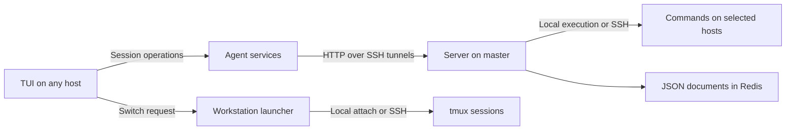

# Architecture

The **server** provides shared JSON storage in Redis and dispatches commands
to the appropriate host. It runs commands directly on its own host and uses SSH
elsewhere. Callers supply the command, arguments and stdin; the server does not interpret
tmux, Codex or filesystem operations, or the documents stored by integrations.
Desktop actions run on the server's machine. Diagnostics check Redis and collect
local doctor reports from agents on the server and configured hosts.

The **agent** owns integrations: it reads local state, publishes snapshots through
generic storage and performs requested actions. For remote operations, it asks the server
to invoke `multienv-agent` with the appropriate command and JSON input.
It also exposes generic host invocation and master desktop commands.
External integrations can use host invocation without changes to the server.

The **TUI** displays sessions across hosts, requests synchronization and refreshes its view. Each snapshot
records when it was taken, so unavailable hosts remain recognizable by their stale data.

The **launcher** owns the interactive terminal connection. A cross-host selection
sends a request back to it, and it attaches to the chosen tmux target locally or
over SSH. The **forwarder** maintains the tunnels that make the server and launcher
reachable from remote hosts. Agents and the server can also be used without the TUI.

**Codex integration** sits on top of this tmux workspace. It adds conversation
discovery and lifecycle commands, maps running conversations to tmux panes, and
uses the existing window and connection workflow to resume inactive conversations.
