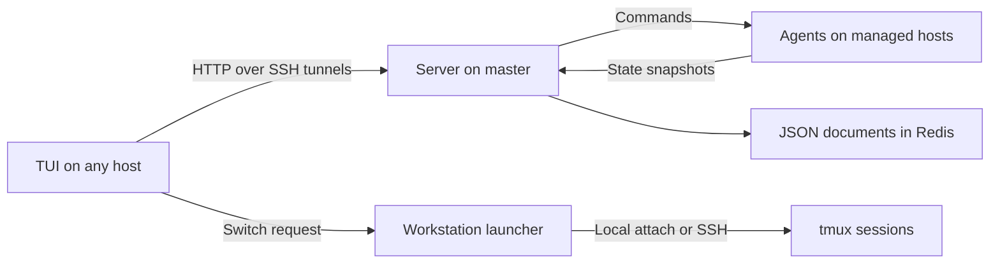

# Architecture

The **server** provides shared JSON storage in Redis and dispatches commands
to the appropriate host. It runs commands directly on its own host and uses SSH
to invoke the agent elsewhere. Desktop actions run on the server's machine.

The **agent** reads local tmux state, publishes snapshots and performs requested
actions. It provides a tmux command tree, additional Codex integration
commands, and master desktop commands. Agents communicate with the server using
HTTP and JSON.

The **TUI** displays sessions across hosts, requests synchronization and refreshes its view. Each snapshot
records when it was taken, so unavailable hosts remain recognizable by their stale data.

The **launcher** owns the interactive terminal connection. A cross-host selection
sends a request back to it, and it attaches to the chosen tmux target locally or
over SSH. The **forwarder** maintains the tunnels that make the server and launcher
reachable from remote hosts. Agents and the server can also be used without the TUI.

**Codex integration** sits on top of this tmux workspace. It adds conversation
discovery and lifecycle commands, maps running conversations to tmux panes, and
uses the existing window and connection workflow to resume inactive conversations.
